# Chart Generation System

<cite>
**Referenced Files in This Document**
- [fpl.py](file://premier-league/fpl.py)
- [main.py](file://DASHBOARD/main.py)
</cite>

## Table of Contents
1. [Introduction](#introduction)
2. [Project Structure](#project-structure)
3. [Core Components](#core-components)
4. [Architecture Overview](#architecture-overview)
5. [Detailed Component Analysis](#detailed-component-analysis)
6. [Dependency Analysis](#dependency-analysis)
7. [Performance Considerations](#performance-considerations)
8. [Troubleshooting Guide](#troubleshooting-guide)
9. [Conclusion](#conclusion)
10. [Appendices](#appendices)

## Introduction
This document explains the chart generation system used across the project to produce statistical visualizations and interactive dashboards. It covers:
- Statistical plotting components for probability distributions, comparative analysis charts, and team performance metrics
- The StatCard component for displaying top performers with customizable styling and accent colors
- The table rendering system that creates responsive data tables with alternating row colors and fixed sizing for export
- Chart customization options including color schemes, font configurations, and layout adjustments
- Examples of creating custom statistical visualizations and integrating new chart types into the dashboard

The system combines two complementary layers:
- Matplotlib-based static infographic charts (dark theme, 1280x720 PNGs)
- PyQt5-based interactive dashboard widgets (cards, tables, map, video playback)

## Project Structure
At a high level, the charting system is split between:
- A dedicated chart generator module that produces styled PNG infographics from simulation results
- A dashboard application that renders cards, tables, maps, and animated progress videos using PyQt5

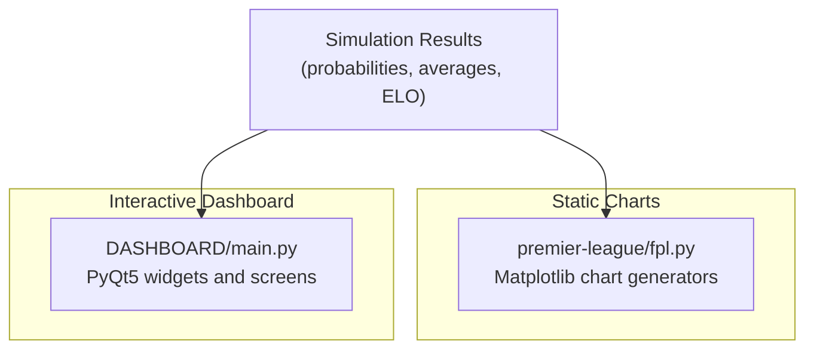

**Diagram sources**
- [fpl.py:354-760](file://premier-league/fpl.py#L354-L760)
- [main.py:68-199](file://DASHBOARD/main.py#L68-L199)

**Section sources**
- [fpl.py:1-108](file://premier-league/fpl.py#L1-L108)
- [main.py:1-63](file://DASHBOARD/main.py#L1-L63)

## Core Components
- Static chart generators:
  - Hero card chart with big number and stacked bar segments
  - Horizontal bars for comparative metrics (e.g., probabilities, points, Elo)
  - Three-big-numbers summary cards
  - Batch chart builder that writes multiple PNGs per season
- Interactive dashboard components:
  - StatCard widget for top performers with accent-colored borders and values
  - Table builders with alternating row colors, fixed column sizing, and export-friendly layouts
  - Detail screen combining cards and full tables
  - Video playback screen showing animated progression of tables over simulations

**Section sources**
- [fpl.py:142-290](file://premier-league/fpl.py#L142-L290)
- [fpl.py:354-760](file://premier-league/fpl.py#L354-L760)
- [main.py:415-439](file://DASHBOARD/main.py#L415-L439)
- [main.py:551-610](file://DASHBOARD/main.py#L551-L610)
- [main.py:618-654](file://DASHBOARD/main.py#L618-L654)
- [main.py:1037-1265](file://DASHBOARD/main.py#L1037-L1265)

## Architecture Overview
The system follows a clear separation of concerns:
- Data preparation and batch chart generation are handled by the static chart module
- User-facing interactivity and presentation are handled by the dashboard module
- Both consume shared simulation outputs (probabilities, averages, ELO ratings)

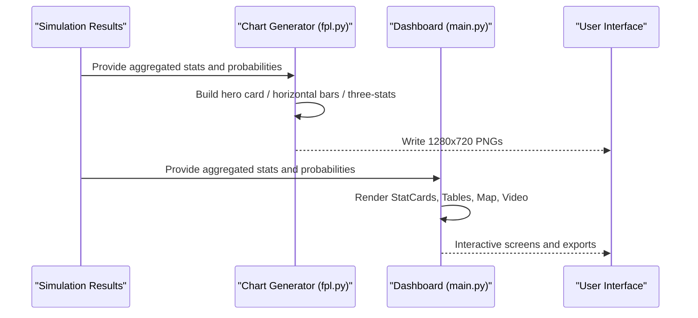

**Diagram sources**
- [fpl.py:354-760](file://premier-league/fpl.py#L354-L760)
- [main.py:618-654](file://DASHBOARD/main.py#L618-L654)
- [main.py:1037-1265](file://DASHBOARD/main.py#L1037-L1265)

## Detailed Component Analysis

### Static Chart Generators (Matplotlib)
Key responsibilities:
- Create consistent 1280x720 dark-themed figures
- Draw hero cards with segmented bars
- Draw horizontal bar charts for comparative analysis
- Draw three-big-numbers summary cards
- Orchestrate batch chart creation

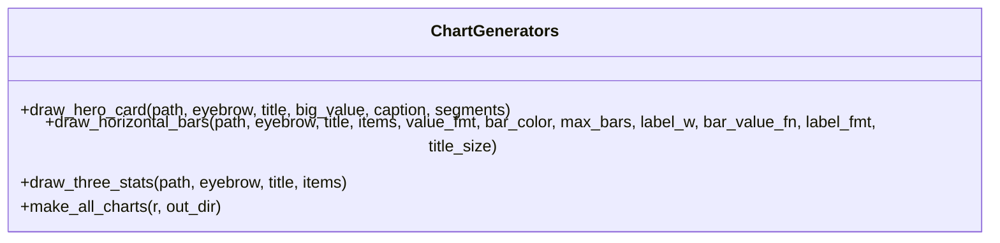

**Diagram sources**
- [fpl.py:142-188](file://premier-league/fpl.py#L142-L188)
- [fpl.py:195-262](file://premier-league/fpl.py#L195-L262)
- [fpl.py:269-290](file://premier-league/fpl.py#L269-L290)
- [fpl.py:354-760](file://premier-league/fpl.py#L354-L760)

#### Hero Card Chart
- Purpose: Display a large headline metric alongside a segmented bar representing composition (e.g., average European spots).
- Inputs: Eyebrow text, title, big numeric value, caption, and segments with values, labels, and colors.
- Output: A single PNG file with a stacked bar and legend under each segment.

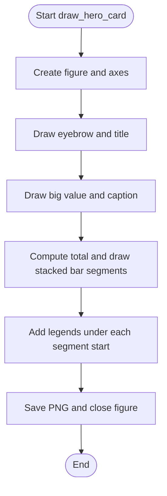

**Diagram sources**
- [fpl.py:142-188](file://premier-league/fpl.py#L142-L188)

**Section sources**
- [fpl.py:142-188](file://premier-league/fpl.py#L142-L188)

#### Horizontal Bars Chart
- Purpose: Compare categorical metrics (e.g., title probability, average points, Elo ratings).
- Inputs: Items as (label, value), optional transform for bar length, formatting strings, and color configuration.
- Output: A single PNG file with aligned labels, proportional bars, and formatted values.

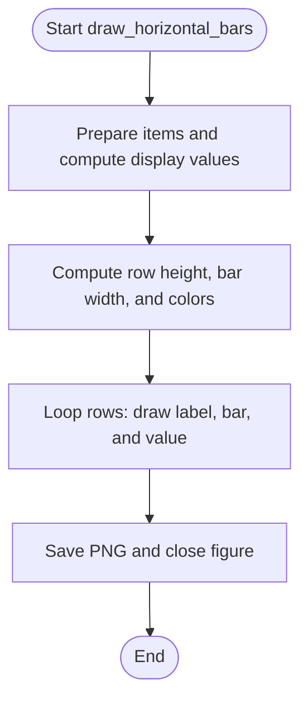

**Diagram sources**
- [fpl.py:195-262](file://premier-league/fpl.py#L195-L262)

**Section sources**
- [fpl.py:195-262](file://premier-league/fpl.py#L195-L262)

#### Three Big Numbers Chart
- Purpose: Present a compact set of key metrics side-by-side.
- Inputs: Eyebrow, title, and items with tag, name, formatted value, and color.
- Output: A single PNG file with three columns of prominent numbers.

**Section sources**
- [fpl.py:269-290](file://premier-league/fpl.py#L269-L290)

#### Batch Chart Builder
- Purpose: Generate all league-related charts in one pass.
- Responsibilities:
  - Compute derived metrics (e.g., sorted probabilities, averages)
  - Call specific chart functions with appropriate parameters
  - Write output files to a designated directory

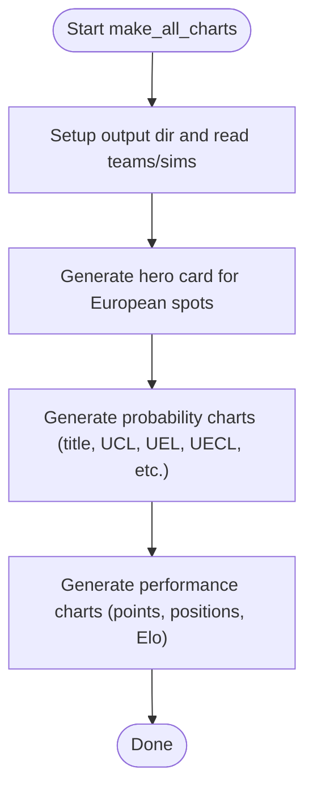

**Diagram sources**
- [fpl.py:354-760](file://premier-league/fpl.py#L354-L760)

**Section sources**
- [fpl.py:354-760](file://premier-league/fpl.py#L354-L760)

### Interactive Dashboard Components (PyQt5)

#### StatCard Component
- Purpose: Display top performers with rank, team name, and formatted value.
- Customization:
  - Accent color applied to border-left stripe and value text
  - Fixed height and internal spacing
  - Consistent typography and alignment

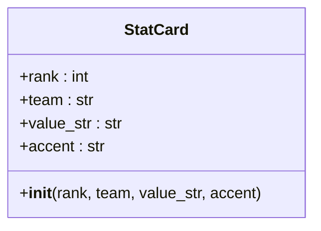

**Diagram sources**
- [main.py:415-439](file://DASHBOARD/main.py#L415-L439)

**Section sources**
- [main.py:415-439](file://DASHBOARD/main.py#L415-L439)

#### Table Rendering System
- Purpose: Create responsive, export-ready data tables with alternating row colors and fixed sizing.
- Features:
  - Alternating row colors via QSS
  - Column resizing strategies (stretch first column, resize others to contents)
  - Fixed dimensions for PNG export and video frames
  - Color-coded cells based on thresholds (for World Cup qualification probabilities)

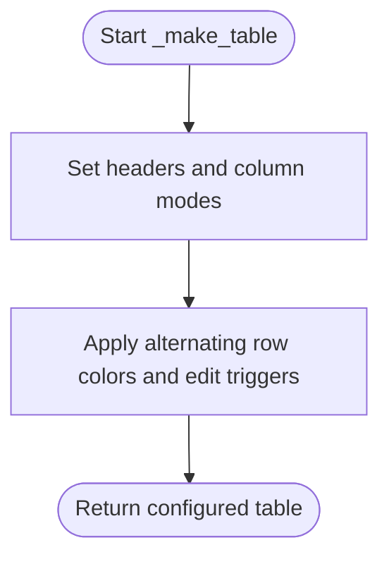

**Diagram sources**
- [main.py:551-562](file://DASHBOARD/main.py#L551-L562)

**Section sources**
- [main.py:551-610](file://DASHBOARD/main.py#L551-L610)

#### Detail Body Composition
- Purpose: Combine StatCards and full tables into a cohesive detail view.
- Behavior:
  - Left panel shows top five cards
  - Right panel shows full table
  - Optional full-size mode for export (fixed table size, no scrollbars)

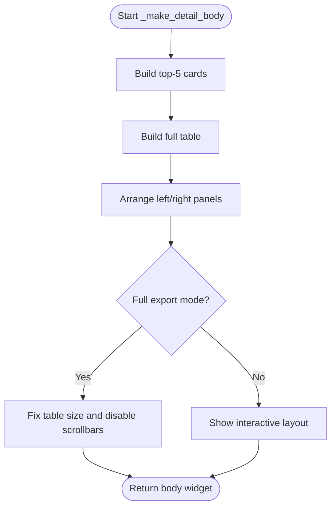

**Diagram sources**
- [main.py:618-654](file://DASHBOARD/main.py#L618-L654)

**Section sources**
- [main.py:618-654](file://DASHBOARD/main.py#L618-L654)

#### Video Playback Screen
- Purpose: Animate table progression over simulations with smooth interpolation.
- Key behaviors:
  - Frozen team order to prevent row swapping during playback
  - Interpolated snapshots for smooth transitions
  - Play/pause controls, slider scrubbing, time display
  - MP4 export using OpenCV and NumPy

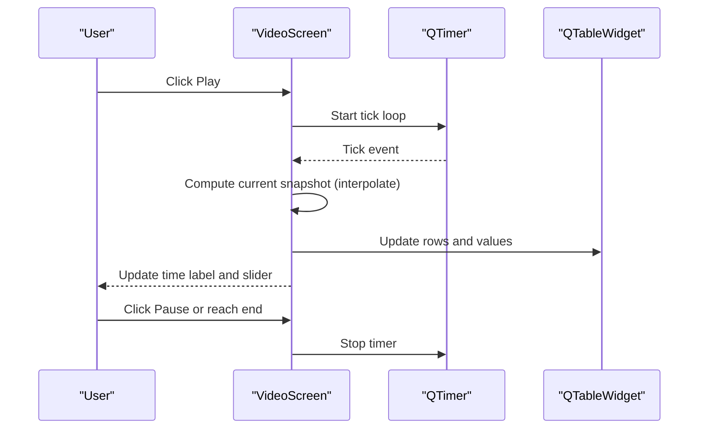

**Diagram sources**
- [main.py:1037-1265](file://DASHBOARD/main.py#L1037-L1265)

**Section sources**
- [main.py:1037-1265](file://DASHBOARD/main.py#L1037-L1265)

## Dependency Analysis
- Static charts depend on:
  - Simulation results dictionary containing probabilities, averages, and ELO ratings
  - Matplotlib for drawing figures and saving PNGs
- Dashboard depends on:
  - Simulation results dictionary
  - PyQt5 for UI components and rendering
  - Optional OpenCV and NumPy for MP4 export

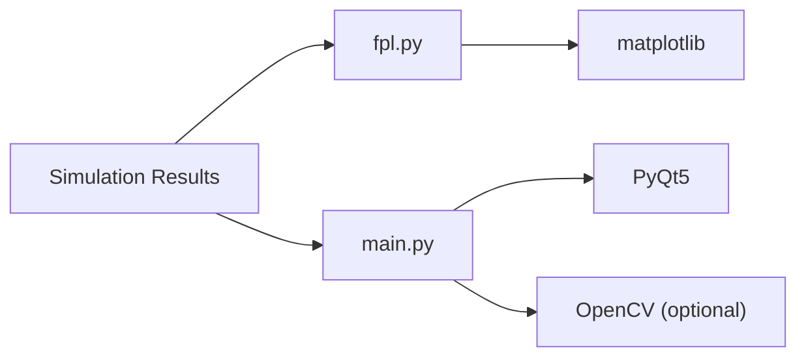

**Diagram sources**
- [fpl.py:45-50](file://premier-league/fpl.py#L45-L50)
- [main.py:20-31](file://DASHBOARD/main.py#L20-L31)
- [main.py:1373-1380](file://DASHBOARD/main.py#L1373-L1380)

**Section sources**
- [fpl.py:45-50](file://premier-league/fpl.py#L45-L50)
- [main.py:20-31](file://DASHBOARD/main.py#L20-L31)
- [main.py:1373-1380](file://DASHBOARD/main.py#L1373-L1380)

## Performance Considerations
- Static charts:
  - Use a fixed canvas size (1280x720) and DPI to ensure consistent output
  - Auto font sizing for long lists to maintain readability
  - Efficient iteration over items when drawing bars
- Dashboard:
  - Fixed table sizing for export avoids dynamic layout recalculations
  - Frozen team order prevents expensive re-sorting during playback
  - Interpolation reduces frame-to-frame changes for smoother animation
- Video export:
  - Uses OpenCV writer; ensure ffmpeg backend is available
  - Progress dialog updates periodically to keep UI responsive

[No sources needed since this section provides general guidance]

## Troubleshooting Guide
- Missing dependencies for MP4 export:
  - Symptom: Error indicating missing opencv-python or numpy
  - Resolution: Install required packages and ensure ffmpeg is available
- PNG export failures:
  - Symptom: RuntimeError when writing PNG
  - Resolution: Verify write permissions and valid file path
- Table rendering issues:
  - Symptom: Misaligned columns or unexpected scrollbars
  - Resolution: Ensure ResizeToContents is applied consistently and fixed sizes are set for export modes

**Section sources**
- [main.py:1373-1380](file://DASHBOARD/main.py#L1373-L1380)
- [main.py:660-686](file://DASHBOARD/main.py#L660-L686)

## Conclusion
The chart generation system provides both static infographic-style charts and an interactive dashboard for exploring simulation outcomes. The static layer focuses on consistent, publication-ready visuals, while the interactive layer emphasizes usability, clarity, and exportability. Together, they enable comprehensive statistical visualization and team performance analysis across multiple competitions.

[No sources needed since this section summarizes without analyzing specific files]

## Appendices

### Chart Customization Options
- Color schemes:
  - Dark background with cream, yellow, teal, light gray, muted, and red accents
- Fonts:
  - DejaVu Sans family configured globally for matplotlib
- Layout:
  - 1280x720 canvas at 100 DPI
  - Title blocks with eyebrow and main title
  - Horizontal bars with configurable label width and value transforms

**Section sources**
- [fpl.py:66-87](file://premier-league/fpl.py#L66-L87)
- [fpl.py:93-108](file://premier-league/fpl.py#L93-L108)
- [fpl.py:128-136](file://premier-league/fpl.py#L128-L136)
- [fpl.py:195-262](file://premier-league/fpl.py#L195-L262)

### Creating Custom Statistical Visualizations
- Steps:
  - Prepare data as sequences of tuples (label, value) or structured segments
  - Choose an appropriate chart function (hero card, horizontal bars, three stats)
  - Configure colors, formats, and layout parameters
  - Call the batch builder or individual chart function to generate PNGs

**Section sources**
- [fpl.py:142-188](file://premier-league/fpl.py#L142-L188)
- [fpl.py:195-262](file://premier-league/fpl.py#L195-L262)
- [fpl.py:269-290](file://premier-league/fpl.py#L269-L290)
- [fpl.py:354-760](file://premier-league/fpl.py#L354-L760)

### Integrating New Chart Types into the Dashboard
- Steps:
  - Extend LEAGUES configuration with new keys, titles, accents, and column definitions
  - Implement result extraction logic for the new metric
  - Add StatCards and table columns to reflect the new data
  - Optionally add video support if snapshots are available

**Section sources**
- [main.py:68-199](file://DASHBOARD/main.py#L68-L199)
- [main.py:534-549](file://DASHBOARD/main.py#L534-L549)
- [main.py:565-610](file://DASHBOARD/main.py#L565-L610)
- [main.py:1037-1265](file://DASHBOARD/main.py#L1037-L1265)