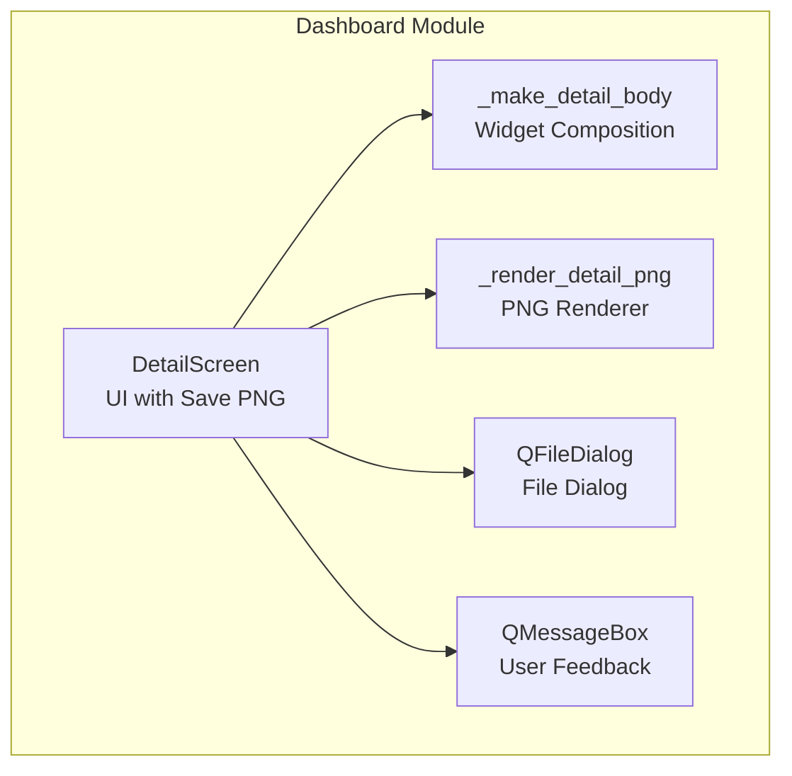
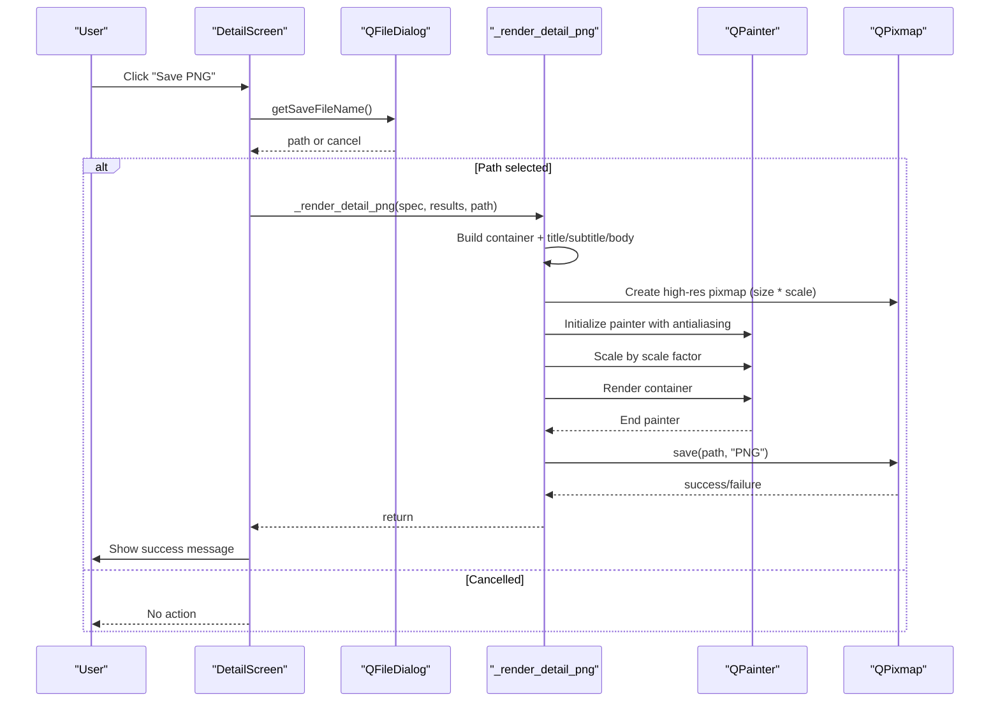
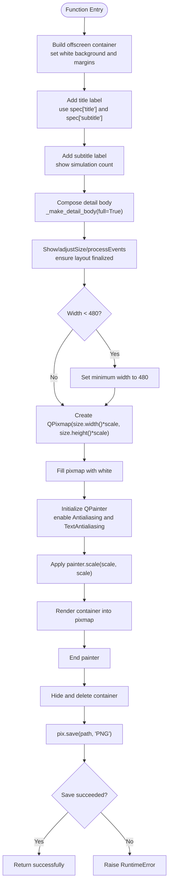
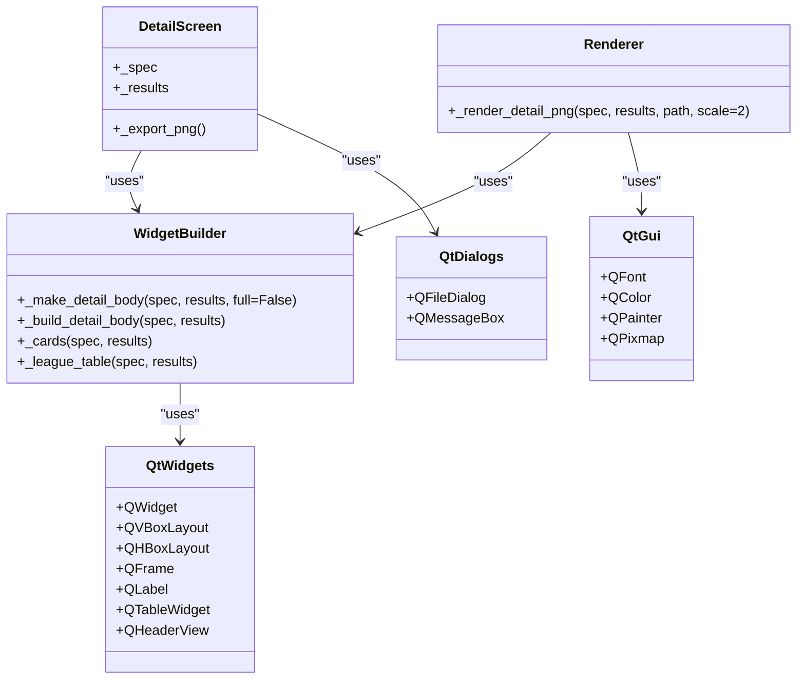

# Image Export Functionality

<cite>
**Referenced Files in This Document**
- [main.py](file://DASHBOARD/main.py)
</cite>

## Table of Contents
1. [Introduction](#introduction)
2. [Project Structure](#project-structure)
3. [Core Components](#core-components)
4. [Architecture Overview](#architecture-overview)
5. [Detailed Component Analysis](#detailed-component-analysis)
6. [Dependency Analysis](#dependency-analysis)
7. [Performance Considerations](#performance-considerations)
8. [Troubleshooting Guide](#troubleshooting-guide)
9. [Conclusion](#conclusion)

## Introduction
This document explains the image export capabilities for generating high-resolution PNG images from PyQt5 widgets using QPainter. It focuses on the publication-quality rendering pipeline, including widget composition, canvas preparation, scaling, anti-aliasing, background styling, and file saving. The primary implementation is contained within the dashboard application’s main module.

## Project Structure
The image export functionality is implemented in a single Python module that contains:
- Widget builders for detail views (cards and tables)
- A dedicated PNG renderer that composes an offscreen container and renders it to a high-resolution pixmap
- UI integration via a “Save PNG” button in the detail screen
- File dialog handling and safe filename generation

**Diagram sources**
- [main.py:1517-1562](file://DASHBOARD/main.py#L1517-L1562)
- [main.py:618-654](file://DASHBOARD/main.py#L618-L654)
- [main.py:660-686](file://DASHBOARD/main.py#L660-L686)

**Section sources**
- [main.py:276-278](file://DASHBOARD/main.py#L276-L278)
- [main.py:618-654](file://DASHBOARD/main.py#L618-L654)
- [main.py:660-686](file://DASHBOARD/main.py#L660-L686)
- [main.py:1517-1562](file://DASHBOARD/main.py#L1517-L1562)

## Core Components
- PNG renderer function: constructs an offscreen QWidget container, composes title/subtitle and detail body, prepares a high-resolution QPixmap, applies anti-aliasing and scaling, renders the widget tree, and saves the result as PNG.
- Detail body builder: creates a two-panel layout containing probability cards and a full table, with special handling for fixed sizing when exporting.
- Detail screen UI: provides a “Save PNG” button that triggers the export workflow and handles user feedback.

Key responsibilities:
- Rendering: QPainter-based rasterization with antialiasing and text antialiasing enabled.
- Scaling: configurable scale factor to produce high-resolution output.
- Styling: white background, consistent margins, and accent colors derived from spec.
- File I/O: save path selection via QFileDialog and error handling.

**Section sources**
- [main.py:660-686](file://DASHBOARD/main.py#L660-L686)
- [main.py:618-654](file://DASHBOARD/main.py#L618-L654)
- [main.py:1517-1562](file://DASHBOARD/main.py#L1517-L1562)

## Architecture Overview
The export workflow integrates UI interaction, widget composition, and pixel-perfect rendering into a cohesive pipeline.

**Diagram sources**
- [main.py:1550-1562](file://DASHBOARD/main.py#L1550-L1562)
- [main.py:660-686](file://DASHBOARD/main.py#L660-L686)

## Detailed Component Analysis

### PNG Renderer: _render_detail_png
Purpose:
- Compose a publication-ready view from spec and results.
- Prepare a high-resolution pixmap and render the widget tree with proper scaling and anti-aliasing.
- Save the rendered image to a PNG file.

Implementation highlights:
- Offscreen container: a QWidget with a white background and generous margins.
- Title and subtitle: styled labels using spec-driven accent color and simulation count.
- Body composition: uses _make_detail_body with full=True to ensure fixed sizing and no scrollbars during export.
- Canvas preparation:
  - Determine container size; enforce minimum width.
  - Create QPixmap sized at base dimensions multiplied by scale.
  - Fill pixmap with white background.
  - Initialize QPainter with Antialiasing and TextAntialiasing enabled.
  - Apply scale transform before rendering.
- Rendering:
  - Render the container into the scaled pixmap.
  - Clean up the container after rendering.
- Saving:
  - Attempt to save as PNG; raise an exception if write fails.

Customization options:
- scale: resolution scaling factor controlling final pixel dimensions (default 2).
- Background color: hard-coded white (#ffffff) for consistent output.
- Margins and spacing: set on the container layout for padding around content.

Complexity considerations:
- Time complexity is dominated by widget layout and painting operations; scales linearly with the number of widgets and their complexity.
- Memory usage increases with the product of base dimensions and scale factor squared.

**Diagram sources**
- [main.py:660-686](file://DASHBOARD/main.py#L660-L686)

**Section sources**
- [main.py:660-686](file://DASHBOARD/main.py#L660-L686)

### Detail Body Builder: _make_detail_body and helpers
Purpose:
- Construct the visual components displayed in the detail view: probability cards and a full table.
- Provide export-specific behavior (fixed sizing, disabling scrollbars) to ensure consistent rendering.

Key functions:
- _build_detail_body: selects between league-specific and World Cup data paths to produce cards and table.
- _cards/_wc_cards: generate StatCard widgets representing top teams and probabilities.
- _league_table/_wc_table: build QTableWidget instances with formatted values and conditional coloring.
- _make_detail_body: assemble left/right panels, apply styles, and configure table for export.

Export-specific adjustments:
- Disable vertical/horizontal scrollbars on the table.
- Resize columns to fit content.
- Compute exact table size based on header height and row sizes, then set a fixed size to avoid dynamic resizing during rendering.

Styling:
- Left panel: light gray background with rounded borders.
- Right panel: white background with rounded borders.
- Accent colors applied to headers and card borders.

**Section sources**
- [main.py:534-548](file://DASHBOARD/main.py#L534-L548)
- [main.py:551-609](file://DASHBOARD/main.py#L551-L609)
- [main.py:612-654](file://DASHBOARD/main.py#L612-L654)

### Detail Screen Integration: DetailScreen._export_png
Purpose:
- Provide a user-facing “Save PNG” button.
- Handle file dialog selection, path normalization, and invoke the renderer.
- Display success or failure messages.

Workflow:
- Default filename constructed from spec title and subtitle using a safe filename helper.
- Open save dialog filtered for PNG files.
- Ensure extension is .png.
- Call _render_detail_png with current spec and results.
- On success, show confirmation; on failure, show warning with error details.

**Section sources**
- [main.py:1517-1562](file://DASHBOARD/main.py#L1517-L1562)
- [main.py:276-278](file://DASHBOARD/main.py#L276-L278)

## Dependency Analysis
The PNG export system depends on several PyQt5 classes and utilities:
- QWidget, QVBoxLayout, QHBoxLayout, QFrame, QLabel, QTableWidget, QHeaderView, QFileDialog, QMessageBox
- QFont, QColor, QPainter, QPixmap
- Application event loop utilities: QApplication.processEvents

Relationships:
- DetailScreen orchestrates user interaction and delegates rendering to _render_detail_png.
- _render_detail_png composes widgets via _make_detail_body and its helpers.
- QPainter operates on a QPixmap created with scaled dimensions.

**Diagram sources**
- [main.py:618-654](file://DASHBOARD/main.py#L618-L654)
- [main.py:660-686](file://DASHBOARD/main.py#L660-L686)
- [main.py:1517-1562](file://DASHBOARD/main.py#L1517-L1562)

**Section sources**
- [main.py:618-654](file://DASHBOARD/main.py#L618-L654)
- [main.py:660-686](file://DASHBOARD/main.py#L660-L686)
- [main.py:1517-1562](file://DASHBOARD/main.py#L1517-L1562)

## Performance Considerations
- Resolution scaling: Increasing the scale factor multiplies both width and height, increasing memory and rendering time quadratically. Use the smallest scale that meets quality requirements.
- Minimum width enforcement: Ensures readability but can increase output size; consider adjusting thresholds based on content density.
- Event processing: QApplication.processEvents is used to finalize layout before rendering; this avoids layout thrashing but may introduce small delays.
- Widget complexity: Large tables and many cards increase rendering time; consider limiting exported content or pre-computing static elements where possible.
- Anti-aliasing: Enabled for smooth edges and text; slight performance cost but improves visual quality.

[No sources needed since this section provides general guidance]

## Troubleshooting Guide
Common issues and resolutions:
- File write failures: If pix.save returns false, a RuntimeError is raised. Check file permissions, disk space, and path validity.
- Blank or low-quality images: Verify that the scale factor is sufficient and that the container has been shown and adjusted before rendering.
- Incorrect layout: Ensure QApplication.processEvents is called after adjustSize so layouts are computed prior to snapshotting.
- Missing extensions: The exporter ensures .png extension; if not provided, it appends automatically.

Operational tips:
- Use a white background consistently to avoid transparency artifacts.
- Keep fonts and colors consistent across widgets to maintain visual coherence.
- For large datasets, reduce the number of rows or disable unnecessary decorations to speed up rendering.

**Section sources**
- [main.py:660-686](file://DASHBOARD/main.py#L660-L686)
- [main.py:1550-1562](file://DASHBOARD/main.py#L1550-L1562)

## Conclusion
The image export system provides a robust, publication-quality PNG rendering pipeline built on PyQt5 and QPainter. By composing widgets in an offscreen container, applying precise scaling and anti-aliasing, and leveraging consistent styling, it produces high-resolution images suitable for reports and presentations. The design separates concerns cleanly between UI orchestration, widget composition, and rendering, enabling straightforward customization of dimensions, scaling factors, and styling parameters while maintaining predictable performance characteristics.

[No sources needed since this section summarizes without analyzing specific files]