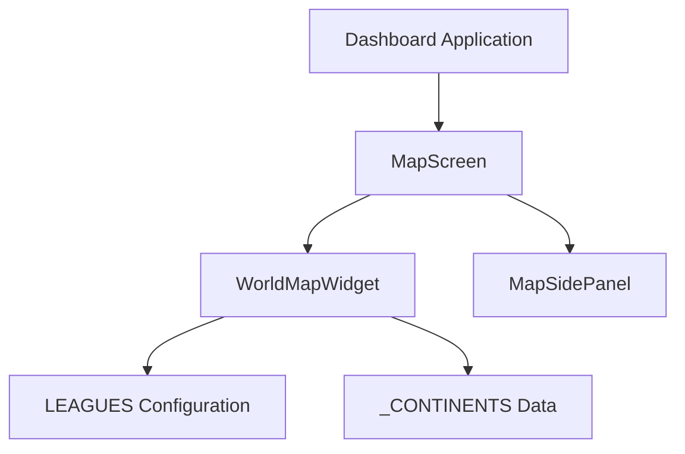
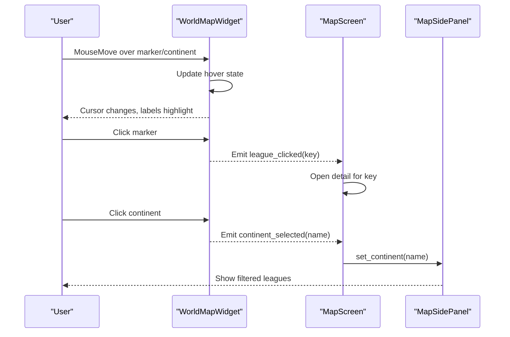
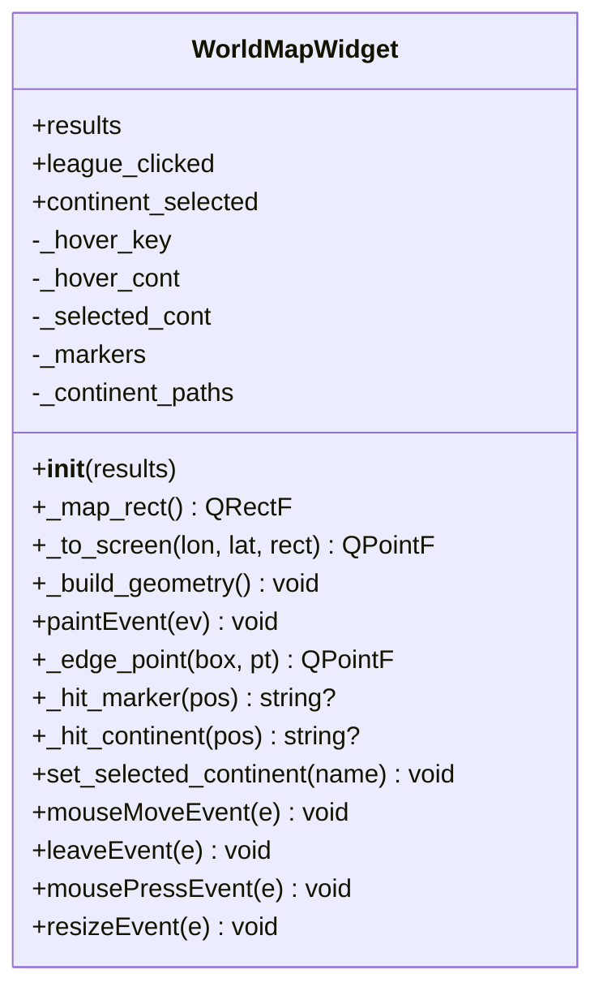
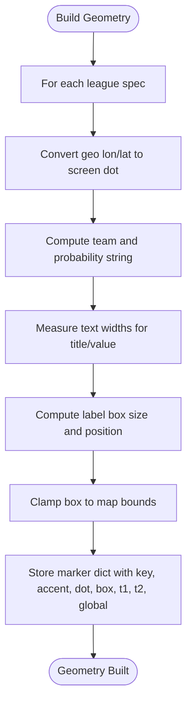
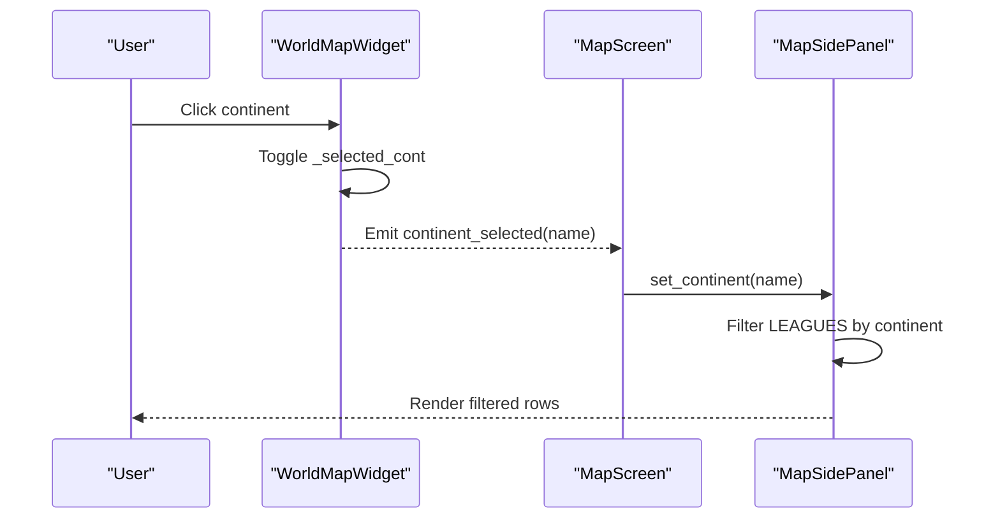
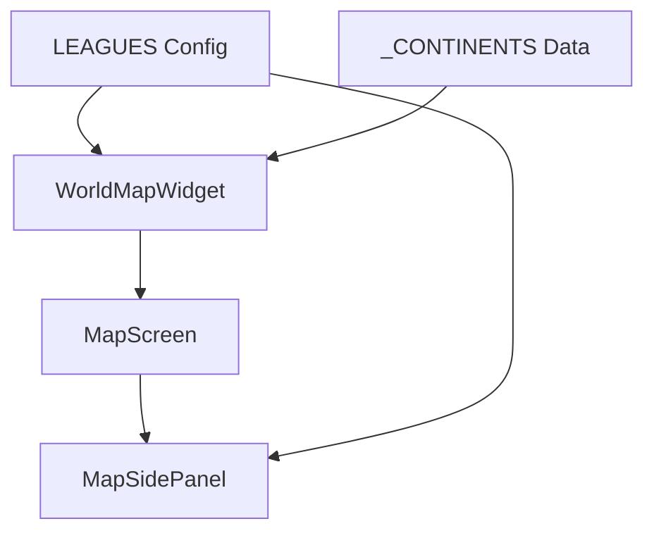

# Interactive World Map Visualization

<cite>
**Referenced Files in This Document**
- [main.py](file://DASHBOARD/main.py)
</cite>

## Table of Contents
1. [Introduction](#introduction)
2. [Project Structure](#project-structure)
3. [Core Components](#core-components)
4. [Architecture Overview](#architecture-overview)
5. [Detailed Component Analysis](#detailed-component-analysis)
6. [Dependency Analysis](#dependency-analysis)
7. [Performance Considerations](#performance-considerations)
8. [Troubleshooting Guide](#troubleshooting-guide)
9. [Conclusion](#conclusion)
10. [Appendices](#appendices)

## Introduction
This document explains the interactive world map visualization system used by the simulation dashboard. It focuses on:
- The WorldMapWidget class that renders continent outlines using QPainterPath with precise geographic coordinate mapping.
- The league marker positioning system that places clickable indicators at appropriate geographic locations with hover interactions and click handlers.
- The continent filtering functionality that allows users to focus on specific regions.
- The tooltip-like label system showing team information and qualification probabilities when hovering over markers.
- Practical examples for adding new league markers, customizing map appearance, and implementing additional interactive features such as zoom controls or legend displays.

The implementation is built with PyQt5 and uses a Mercator-style projection to convert longitude/latitude coordinates into screen coordinates.

## Project Structure
The interactive map is implemented within the dashboard application file. Key elements include:
- A global LEAGUES configuration defining each competition’s metadata, geographic placement, and rendering hints.
- A _CONTINENTS dictionary containing polygonal outlines for continents in geographic coordinates.
- The WorldMapWidget class responsible for drawing the map, handling mouse interactions, and emitting signals for clicks and continent selection.
- Supporting UI components like MapSidePanel and MapScreen that integrate the map with the rest of the dashboard.

**Diagram sources**
- [main.py:68-199](file://DASHBOARD/main.py#L68-L199)
- [main.py:692-736](file://DASHBOARD/main.py#L692-L736)
- [main.py:742-907](file://DASHBOARD/main.py#L742-L907)
- [main.py:913-1004](file://DASHBOARD/main.py#L913-L1004)

**Section sources**
- [main.py:68-199](file://DASHBOARD/main.py#L68-L199)
- [main.py:692-736](file://DASHBOARD/main.py#L692-L736)
- [main.py:742-907](file://DASHBOARD/main.py#L742-L907)
- [main.py:913-1004](file://DASHBOARD/main.py#L913-L1004)

## Core Components
- WorldMapWidget: Renders the world map, draws continent paths, positions league markers, handles hover and click events, and emits signals for user interactions.
- LEAGUES: Central configuration listing all leagues with titles, accents, geographic coordinates (lon, lat), offsets (dx, dy), and data accessors for teams and probabilities.
- _CONTINENTS: Geographic polygons for continents used to build QPainterPath objects for hit-testing and visual highlighting.
- MapSidePanel: Displays a filtered list of leagues based on selected continent and provides “Show all” control.
- MapScreen: Orchestrates the map widget and side panel, wiring signals between them.

Key responsibilities:
- Coordinate mapping from geographic lon/lat to screen coordinates via a simple projection.
- Building continent geometry once per resize and caching it for efficient painting.
- Computing marker boxes and dots based on league geo and dynamic text metrics.
- Handling mouse move/leave/click events to update hover state and emit signals.

**Section sources**
- [main.py:68-199](file://DASHBOARD/main.py#L68-L199)
- [main.py:692-736](file://DASHBOARD/main.py#L692-L736)
- [main.py:742-907](file://DASHBOARD/main.py#L742-L907)
- [main.py:913-1004](file://DASHBOARD/main.py#L913-L1004)

## Architecture Overview
The map visualization integrates with the dashboard through signals and slots:
- WorldMapWidget emits league_clicked when a marker is clicked.
- WorldMapWidget emits continent_selected when a continent is toggled.
- MapScreen connects these signals to open detail screens and filter the side panel.

**Diagram sources**
- [main.py:742-907](file://DASHBOARD/main.py#L742-L907)
- [main.py:913-1004](file://DASHBOARD/main.py#L913-L1004)

## Detailed Component Analysis

### WorldMapWidget Class
Responsibilities:
- Initialize state: results, hover keys, selected continent, markers, continent paths.
- Compute map rectangle with margins and aspect ratio constraints.
- Convert geographic coordinates to screen coordinates.
- Build continent QPainterPath objects and cache them.
- Build league markers with dot positions and label boxes; compute text widths dynamically.
- Paint background gradient, grid lines, continent fills, borders, hover chips, and marker labels.
- Handle mouse events: move, leave, press; detect hits against markers and continent paths.
- Emit signals: league_clicked and continent_selected.

Coordinate Mapping:
- Uses a linear projection: x = left + (lon + 180)/360 * width; y = top + (90 - lat)/180 * height.
- Ensures proper scaling and centering within the widget’s available area.

Continent Rendering:
- Draws filled paths with different colors for hovered/selected continents.
- Draws a rounded rectangle border around the map area.

Marker Rendering:
- Draws dashed connector lines from dot to box edge.
- Draws ellipses for dots; special treatment for global markers (e.g., World Cup).
- Draws rounded rectangles for label boxes and text for league title and leader probability.

Hit Testing:
- Marker hit: checks if point is inside label box or within a threshold distance to the dot.
- Continent hit: checks if point is inside any continent path.

Interaction:
- Updates cursor to pointing hand when hovering over interactive elements.
- Clears hover state on leave.
- Toggles selected continent on click; emits signal with current selection.

**Diagram sources**
- [main.py:742-907](file://DASHBOARD/main.py#L742-L907)

**Section sources**
- [main.py:742-907](file://DASHBOARD/main.py#L742-L907)

### League Markers and Tooltip System
Markers are computed from LEAGUES entries:
- Each league has a geo object with lon, lat, dx, dy.
- Dot position is converted from geographic coordinates to screen coordinates.
- Label box dimensions are calculated using font metrics for both title and value lines.
- Box is clamped to stay within the map rectangle bounds.
- Hover state highlights the marker and updates cursor.
- Labels show league short title and top team with formatted probability string.

Tooltip Behavior:
- There is no separate tooltip widget; instead, the label box acts as an inline tooltip showing team info and probability.
- Hovering over a marker emphasizes its label box and connector line.

**Diagram sources**
- [main.py:777-804](file://DASHBOARD/main.py#L777-L804)
- [main.py:253-273](file://DASHBOARD/main.py#L253-L273)

**Section sources**
- [main.py:68-199](file://DASHBOARD/main.py#L68-L199)
- [main.py:253-273](file://DASHBOARD/main.py#L253-L273)
- [main.py:777-804](file://DASHBOARD/main.py#L777-L804)

### Continent Filtering Functionality
- Users can click on a continent to toggle selection.
- Selected continent is highlighted visually and stored in _selected_cont.
- MapSidePanel reacts to continent_selected signal and filters the displayed leagues accordingly.
- “Show all competitions” button clears the selection and resets the panel.

**Diagram sources**
- [main.py:880-904](file://DASHBOARD/main.py#L880-L904)
- [main.py:913-965](file://DASHBOARD/main.py#L913-L965)

**Section sources**
- [main.py:880-904](file://DASHBOARD/main.py#L880-L904)
- [main.py:913-965](file://DASHBOARD/main.py#L913-L965)

### Adding New League Markers
To add a new league marker:
- Add a new entry to the LEAGUES list with required fields:
  - key: unique identifier
  - title and short: display names
  - subtitle: season or context
  - accent: color for branding
  - continent: region name matching _CONTINENTS keys
  - geo: object with lon, lat, dx, dy
  - n_sims: number of simulations
  - runner: function to run simulation
  - get_teams: function returning team list
  - top_key and top_fmt: metric key and formatting string
  - columns: table column definitions
- Ensure the continent name matches one of the keys in _CONTINENTS so filtering works correctly.
- Optionally set has_video flag to enable video playback support.

Example structure reference:
- See existing league entries for format and field usage.

**Section sources**
- [main.py:68-199](file://DASHBOARD/main.py#L68-L199)

### Customizing Map Appearance
- Background gradient: Adjusted in paintEvent using QLinearGradient.
- Grid lines: Drawn at fixed intervals for longitude and latitude.
- Continent fill colors: Differentiate hovered/selected vs default.
- Border styling: Rounded rectangle around the map area.
- Marker styles: Ellipse sizes, connector line dash patterns, label box rounding, and text fonts/colors.

Customization points:
- Modify colors and pens in paintEvent for visual themes.
- Adjust margin and aspect ratio logic in _map_rect for layout preferences.
- Change font metrics and label box sizing in _build_geometry for typography tweaks.

**Section sources**
- [main.py:806-859](file://DASHBOARD/main.py#L806-L859)
- [main.py:759-775](file://DASHBOARD/main.py#L759-L775)
- [main.py:777-804](file://DASHBOARD/main.py#L777-L804)

### Implementing Additional Interactive Features
Zoom Controls:
- Introduce zoom level state in WorldMapWidget.
- Modify _to_screen to scale coordinates by zoom factor.
- Provide slider or buttons to adjust zoom; recompute geometry on change.

Legend Display:
- Add a legend widget alongside the map showing league colors and meanings.
- Populate legend entries from LEAGUES specs.
- Update legend on filter changes.

Additional Tooltips:
- Replace inline label boxes with Qt tooltips for richer content.
- Use QWidget.setToolTip on marker hit detection.
- Show detailed stats beyond team and probability.

Implementation guidance:
- Extend WorldMapWidget with new state variables and event handlers.
- Wire UI controls to update internal state and call update() to repaint.
- Ensure geometry recomputation respects new interactive parameters.

[No sources needed since this section provides general guidance]

## Dependency Analysis
Components and their relationships:
- WorldMapWidget depends on LEAGUES and _CONTINENTS for data.
- MapScreen depends on WorldMapWidget and MapSidePanel for orchestration.
- MapSidePanel depends on LEAGUES for filtering and rendering rows.
- Signals connect interaction events to UI updates across components.

**Diagram sources**
- [main.py:68-199](file://DASHBOARD/main.py#L68-L199)
- [main.py:692-736](file://DASHBOARD/main.py#L692-L736)
- [main.py:742-907](file://DASHBOARD/main.py#L742-L907)
- [main.py:913-1004](file://DASHBOARD/main.py#L913-L1004)

**Section sources**
- [main.py:68-199](file://DASHBOARD/main.py#L68-L199)
- [main.py:692-736](file://DASHBOARD/main.py#L692-L736)
- [main.py:742-907](file://DASHBOARD/main.py#L742-L907)
- [main.py:913-1004](file://DASHBOARD/main.py#L913-L1004)

## Performance Considerations
- Geometry caching: Continent paths and marker geometries are rebuilt only on resize to avoid unnecessary recomputation.
- Hit testing efficiency: Marker hit tests iterate over a small list of markers; continent hit tests iterate over continent paths.
- Painting optimization: Antialiasing and text antialiasing are enabled; clipping is used for grid lines.
- Event handling: Minimal state updates and selective repaints via update().

Recommendations:
- Avoid heavy computations in paintEvent; precompute where possible.
- Debounce frequent resize events if necessary.
- Consider spatial indexing for large numbers of markers or complex continent shapes.

[No sources needed since this section provides general guidance]

## Troubleshooting Guide
Common issues and resolutions:
- Markers not appearing:
  - Verify LEAGUES geo coordinates are valid and within expected ranges.
  - Check that _build_geometry runs after widget initialization and resize.
- Continent filtering not working:
  - Ensure continent names in LEAGUES match keys in _CONTINENTS.
  - Confirm continent_selected signal is connected to MapSidePanel.set_continent.
- Hover interactions not updating:
  - Ensure setMouseTracking(True) is called.
  - Check mouseMoveEvent and leaveEvent implementations.
- Signal connections missing:
  - Verify MapScreen wires league_clicked and continent_selected properly.

Debugging tips:
- Print hover_key and hover_cont during mouseMoveEvent to confirm hit detection.
- Inspect marker boxes and dots to ensure they are within map bounds.
- Validate painter operations and pen/brush settings in paintEvent.

**Section sources**
- [main.py:742-907](file://DASHBOARD/main.py#L742-L907)
- [main.py:913-1004](file://DASHBOARD/main.py#L913-L1004)

## Conclusion
The interactive world map visualization system provides a robust foundation for displaying league markers and continent filtering within a PyQt5-based dashboard. The WorldMapWidget class encapsulates coordinate mapping, geometry building, rendering, and interaction handling. By extending the LEAGUES configuration and leveraging the existing signal-slot architecture, developers can easily add new markers, customize appearance, and implement advanced features like zoom controls and legends.

[No sources needed since this section summarizes without analyzing specific files]

## Appendices

### API Reference Summary
- WorldMapWidget methods:
  - __init__: Initializes widget state and builds geometry.
  - _map_rect: Computes map rectangle with margins and aspect ratio.
  - _to_screen: Converts geographic coordinates to screen coordinates.
  - _build_geometry: Builds continent paths and marker data.
  - paintEvent: Renders background, grid, continents, and markers.
  - _edge_point: Calculates edge point for connector lines.
  - _hit_marker: Detects marker hits.
  - _hit_continent: Detects continent hits.
  - set_selected_continent: Sets selected continent programmatically.
  - mouseMoveEvent: Handles hover state updates.
  - leaveEvent: Clears hover state on leave.
  - mousePressEvent: Handles clicks for markers and continents.
  - resizeEvent: Rebuilds geometry on resize.

- LEAGUES fields:
  - key, title, short, subtitle, accent, continent, geo, n_sims, runner, get_teams, top_key, top_fmt, columns, has_video, is_wc.

- _CONTINENTS keys:
  - North America, South America, Europe, Africa, Asia, Oceania.

**Section sources**
- [main.py:68-199](file://DASHBOARD/main.py#L68-L199)
- [main.py:692-736](file://DASHBOARD/main.py#L692-L736)
- [main.py:742-907](file://DASHBOARD/main.py#L742-L907)