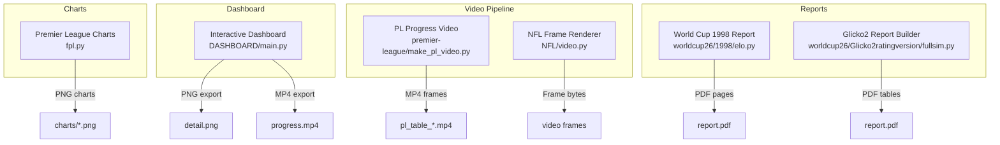
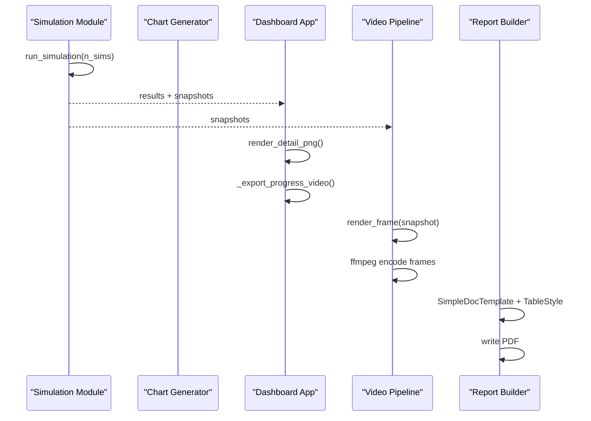
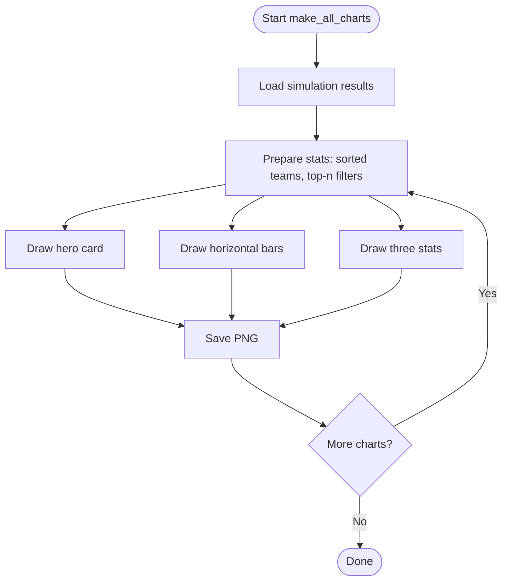
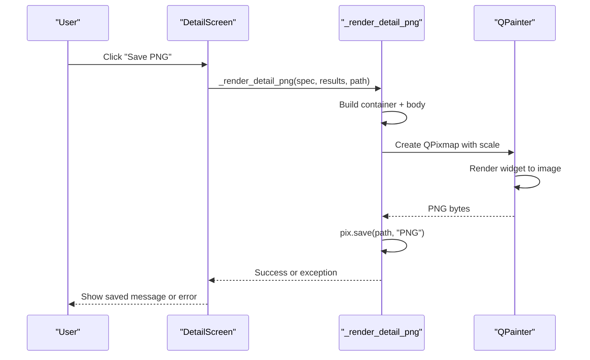
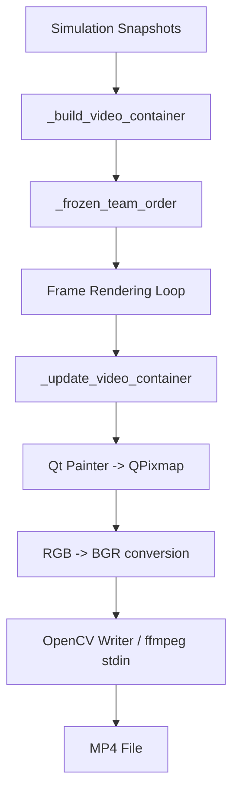
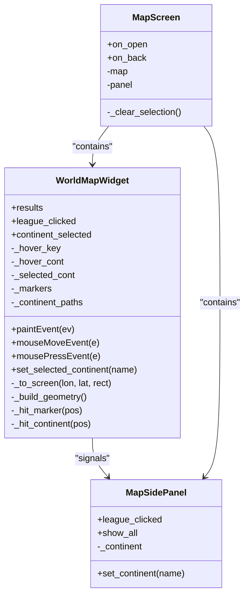
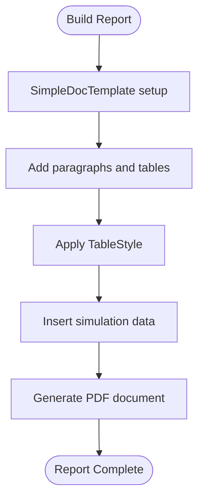
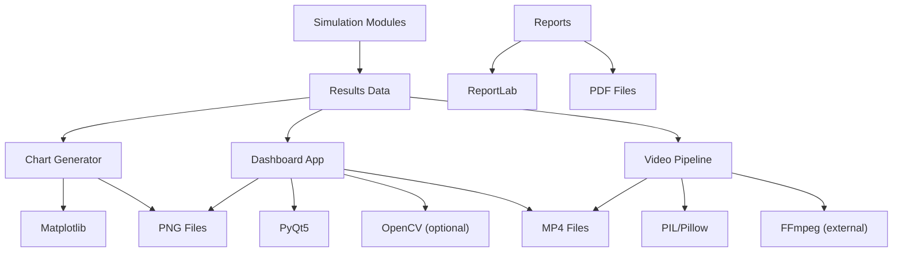

# Visualization and Reporting

<cite>
**Referenced Files in This Document**   
- [fpl.py](file://premier-league/fpl.py)
- [make_pl_video.py](file://premier-league/make_pl_video.py)
- [main.py](file://DASHBOARD/main.py)
- [elo.py](file://worldcup26/1998/elo.py)
- [fullsim.py](file://worldcup26/Glicko2ratingversion/fullsim.py)
</cite>

## Table of Contents
1. [Introduction](#introduction)
2. [Project Structure](#project-structure)
3. [Core Components](#core-components)
4. [Architecture Overview](#architecture-overview)
5. [Detailed Component Analysis](#detailed-component-analysis)
6. [Dependency Analysis](#dependency-analysis)
7. [Performance Considerations](#performance-considerations)
8. [Troubleshooting Guide](#troubleshooting-guide)
9. [Conclusion](#conclusion)

## Introduction
This document explains the visualization and reporting capabilities across the project, focusing on:
- Chart generation for statistical plots, probability distributions, and comparative analysis
- High-resolution PNG export with customizable styling and formatting
- Animated video generation that shows table evolution over time
- Interactive world map visualization with continent filtering, league marker positioning, and hover interactions
- Report formatting options, template customization, and automated report generation workflows
- Performance considerations for large datasets and rendering efficiency

The system combines static charting, interactive dashboards, animated videos, and PDF-style reports to present Monte Carlo simulation results from multiple sports leagues and tournaments.

## Project Structure
The visualization and reporting features are primarily implemented in three areas:
- Premier League chart generator producing styled 1280x720 PNGs
- Dashboard application providing interactive screens, world map, detail views, PNG export, and MP4 export
- Video pipeline generating progressive simulations as MP4 files
- Report templates using a PDF library for structured documents

**Diagram sources**
- [fpl.py:1-804](file://premier-league/fpl.py#L1-L804)
- [main.py:1-1633](file://DASHBOARD/main.py#L1-L1633)
- [make_pl_video.py:1-308](file://premier-league/make_pl_video.py#L1-L308)
- [elo.py:1-200](file://worldcup26/1998/elo.py#L1-L200)
- [fullsim.py:1820-1844](file://worldcup26/Glicko2ratingversion/fullsim.py#L1820-L1844)

**Section sources**
- [fpl.py:1-804](file://premier-league/fpl.py#L1-L804)
- [main.py:1-1633](file://DASHBOARD/main.py#L1-L1633)
- [make_pl_video.py:1-308](file://premier-league/make_pl_video.py#L1-L308)
- [elo.py:1-200](file://worldcup26/1998/elo.py#L1-L200)
- [fullsim.py:1820-1844](file://worldcup26/Glicko2ratingversion/fullsim.py#L1820-L1844)

## Core Components
- Chart Generator (Premier League): Produces 25 infographic-style PNGs covering title probabilities, qualification chances, European performance, Elo ratings, and more. Uses Matplotlib with custom color palettes and fixed canvas dimensions.
- Dashboard Application: Provides multi-screen navigation including progress tracking, home grid, world map, detail view, and video playback. Supports high-resolution PNG export and MP4 export of evolving tables.
- Video Pipeline: Renders per-simulation snapshots into an MP4 with parallel frame rendering and ffmpeg integration. Includes audio looping and configurable duration.
- Report Templates: Uses a PDF library to build structured documents with styled tables, paragraphs, and page layouts.

**Section sources**
- [fpl.py:1-804](file://premier-league/fpl.py#L1-L804)
- [main.py:1-1633](file://DASHBOARD/main.py#L1-L1633)
- [make_pl_video.py:1-308](file://premier-league/make_pl_video.py#L1-L308)
- [elo.py:1-200](file://worldcup26/1998/elo.py#L1-L200)
- [fullsim.py:1820-1844](file://worldcup26/Glicko2ratingversion/fullsim.py#L1820-L1844)

## Architecture Overview
The visualization and reporting architecture integrates several subsystems:
- Simulation modules produce results and snapshots
- Chart generator consumes results to create static PNGs
- Dashboard renders interactive UIs and exports media
- Video pipeline converts snapshots into animated MP4s
- Report builders assemble PDF documents with tables and narratives

**Diagram sources**
- [main.py:284-331](file://DASHBOARD/main.py#L284-L331)
- [main.py:1373-1456](file://DASHBOARD/main.py#L1373-L1456)
- [make_pl_video.py:214-308](file://premier-league/make_pl_video.py#L214-L308)
- [elo.py:6-13](file://worldcup26/1998/elo.py#L6-L13)

## Detailed Component Analysis

### Chart Generation System
The chart generator produces 25 distinct visualizations:
- Hero cards with big numbers and stacked bars
- Horizontal bar charts for probabilities and statistics
- Three-stat cards for summary metrics
- Custom color palette and typography for consistent branding

Key capabilities:
- Statistical plots: average points, finish positions, thresholds
- Probability distributions: title race, UCL/UEL/UECL qualification, relegation
- Comparative analysis: association coefficients, Elo ratings, European win chances

Rendering details:
- Fixed 1280x720 canvas at 100 DPI
- Dark green background with cream/yellow/teal accents
- Automatic font sizing for long tables
- Clean PNG output with directory management

**Diagram sources**
- [fpl.py:354-760](file://premier-league/fpl.py#L354-L760)
- [fpl.py:142-290](file://premier-league/fpl.py#L142-L290)

**Section sources**
- [fpl.py:1-804](file://premier-league/fpl.py#L1-L804)

### Image Export Functionality
High-resolution PNG export is implemented in two contexts:
- Static charts via Matplotlib savefig
- Dashboard detail views via Qt painter scaling

Features:
- Configurable DPI and canvas size
- Antialiasing enabled for crisp text and graphics
- Background color customization
- Directory creation and file writing with error handling

Export workflow:
- Build widget hierarchy with titles, subtitles, and data tables
- Render to offscreen QPixmap with scale factor
- Convert to PNG format and save to disk

**Diagram sources**
- [main.py:1517-1562](file://DASHBOARD/main.py#L1517-L1562)
- [main.py:660-686](file://DASHBOARD/main.py#L660-L686)

**Section sources**
- [main.py:660-686](file://DASHBOARD/main.py#L660-L686)
- [main.py:1517-1562](file://DASHBOARD/main.py#L1517-L1562)

### Animated Video Generation System
Two video systems exist:
- Dashboard MP4 export: Converts Qt-rendered frames to MP4 using OpenCV
- Premier League video pipeline: Parallel frame rendering with ffmpeg

Capabilities:
- Progressive simulation display showing table evolution
- Interpolated snapshots for smooth transitions
- Configurable duration and frame rate
- Audio looping support (PL pipeline)

Rendering pipeline:
- Capture snapshots during simulation runs
- Build video container with frozen team order
- Render frames at target resolution
- Encode with ffmpeg or OpenCV writer

**Diagram sources**
- [main.py:1268-1456](file://DASHBOARD/main.py#L1268-L1456)
- [make_pl_video.py:73-141](file://premier-league/make_pl_video.py#L73-L141)
- [make_pl_video.py:248-308](file://premier-league/make_pl_video.py#L248-L308)

**Section sources**
- [main.py:1037-1456](file://DASHBOARD/main.py#L1037-L1456)
- [make_pl_video.py:1-308](file://premier-league/make_pl_video.py#L1-L308)

### Interactive World Map Visualization
The dashboard includes a comprehensive world map with:
- Continent filtering via click interactions
- League marker positioning based on geographic coordinates
- Hover effects highlighting continents and markers
- Side panel listing competitions filtered by continent

Implementation details:
- Custom QPainter-based rendering for continents and markers
- Coordinate transformation from lon/lat to screen space
- Hit detection for markers and continent polygons
- Signal-based communication between map and side panel

**Diagram sources**
- [main.py:742-907](file://DASHBOARD/main.py#L742-L907)
- [main.py:913-1004](file://DASHBOARD/main.py#L913-L1004)

**Section sources**
- [main.py:692-907](file://DASHBOARD/main.py#L692-L907)
- [main.py:913-1004](file://DASHBOARD/main.py#L913-L1004)

### Report Formatting Options and Template Customization
Report generation uses a PDF library to create structured documents:
- Page layout configuration with letter-sized pages
- Styled tables with headers, alternating colors, and borders
- Paragraph styles for headings and body text
- Dynamic content insertion for simulation results

Template customization includes:
- Column width configuration for optimal readability
- Font sizing and alignment settings
- Color schemes for headers and backgrounds
- Spacing and padding adjustments

**Diagram sources**
- [elo.py:6-13](file://worldcup26/1998/elo.py#L6-L13)
- [fullsim.py:1820-1844](file://worldcup26/Glicko2ratingversion/fullsim.py#L1820-L1844)

**Section sources**
- [elo.py:1-200](file://worldcup26/1998/elo.py#L1-L200)
- [fullsim.py:1820-1844](file://worldcup26/Glicko2ratingversion/fullsim.py#L1820-L1844)

## Dependency Analysis
The visualization and reporting system has clear dependency relationships:

**Diagram sources**
- [fpl.py:45-50](file://premier-league/fpl.py#L45-L50)
- [main.py:20-31](file://DASHBOARD/main.py#L20-L31)
- [make_pl_video.py:25-26](file://premier-league/make_pl_video.py#L25-L26)
- [elo.py:6-13](file://worldcup26/1998/elo.py#L6-L13)

**Section sources**
- [fpl.py:45-50](file://premier-league/fpl.py#L45-L50)
- [main.py:20-31](file://DASHBOARD/main.py#L20-L31)
- [make_pl_video.py:25-26](file://premier-league/make_pl_video.py#L25-L26)
- [elo.py:6-13](file://worldcup26/1998/elo.py#L6-L13)

## Performance Considerations
Several optimization techniques are employed throughout the system:

### Chart Generation
- Batch processing of 25 charts with consistent styling
- Efficient data preparation with sorting and filtering
- Memory cleanup after each chart save
- Fixed canvas dimensions for predictable rendering

### Dashboard Rendering
- Offscreen rendering for PNG export to avoid UI updates
- Antialiasing enabled for high-quality output
- Scaled pixel maps for high-resolution images
- Widget reuse and proper cleanup to prevent memory leaks

### Video Generation
- Parallel frame rendering using ProcessPoolExecutor
- Queue-based producer-consumer pattern for frame processing
- Optimized ffmpeg command line with appropriate codecs
- Audio streaming without blocking video encoding

### Large Dataset Handling
- Snapshot interpolation for smooth animations
- Frozen team ordering to prevent row swapping
- Efficient data structures for probability calculations
- Incremental rendering for large tables

**Section sources**
- [fpl.py:103-125](file://premier-league/fpl.py#L103-L125)
- [main.py:673-684](file://DASHBOARD/main.py#L673-L684)
- [make_pl_video.py:280-295](file://premier-league/make_pl_video.py#L280-L295)

## Troubleshooting Guide

### Common Issues and Solutions

#### PNG Export Failures
- **Issue**: Could not write PNG file
- **Cause**: Permission issues or invalid path
- **Solution**: Check file permissions and ensure directory exists

#### Video Export Dependencies
- **Issue**: Missing OpenCV or numpy for MP4 export
- **Cause**: Optional dependencies not installed
- **Solution**: Install opencv-python and numpy packages

#### FFmpeg Integration
- **Issue**: FFmpeg could not open output file
- **Cause**: Missing codec or invalid path
- **Solution**: Install ffmpeg and verify output path permissions

#### Font Loading Problems
- **Issue**: Fonts not found in video rendering
- **Cause**: Platform-specific font paths
- **Solution**: Ensure fonts are available or use fallback fonts

#### Memory Issues with Large Datasets
- **Issue**: High memory usage during rendering
- **Cause**: Too many widgets or large images
- **Solution**: Use batch processing and proper cleanup

**Section sources**
- [main.py:685-686](file://DASHBOARD/main.py#L685-L686)
- [main.py:1375-1380](file://DASHBOARD/main.py#L1375-L1380)
- [main.py:1404-1407](file://DASHBOARD/main.py#L1404-L1407)
- [make_pl_video.py:49-55](file://premier-league/make_pl_video.py#L49-L55)

## Conclusion
The visualization and reporting system provides comprehensive tools for presenting sports simulation results through multiple formats:
- Static charts for detailed statistical analysis
- Interactive dashboards for exploration and presentation
- Animated videos for dynamic storytelling
- Structured reports for documentation and sharing

The system balances performance with quality, offering both real-time interactivity and high-fidelity output suitable for various audiences and use cases. The modular architecture allows for easy extension and customization while maintaining consistency across different visualization types.